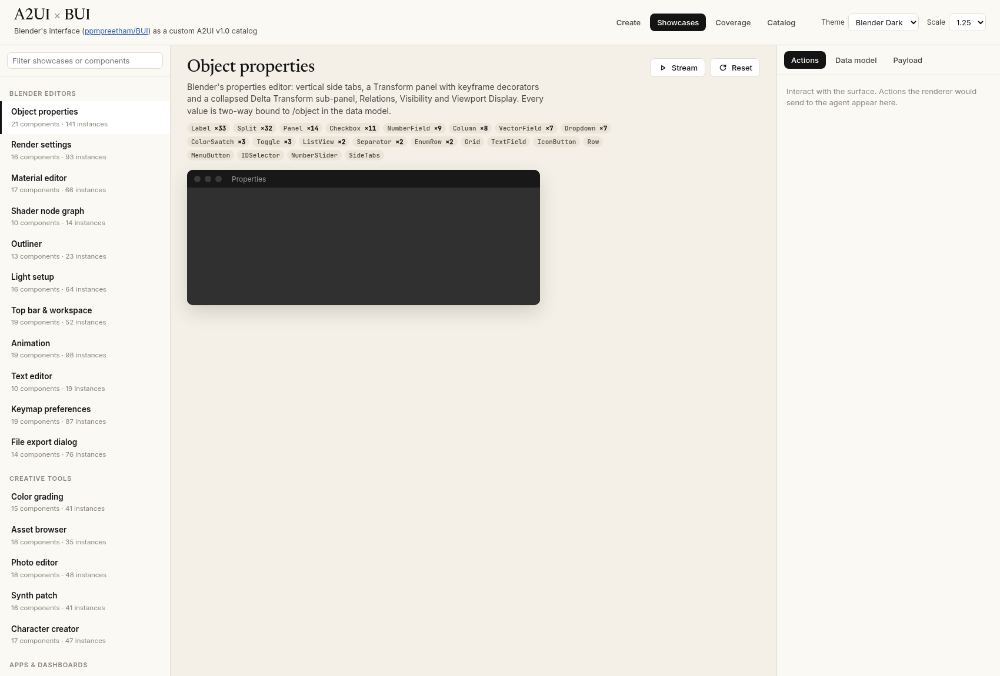
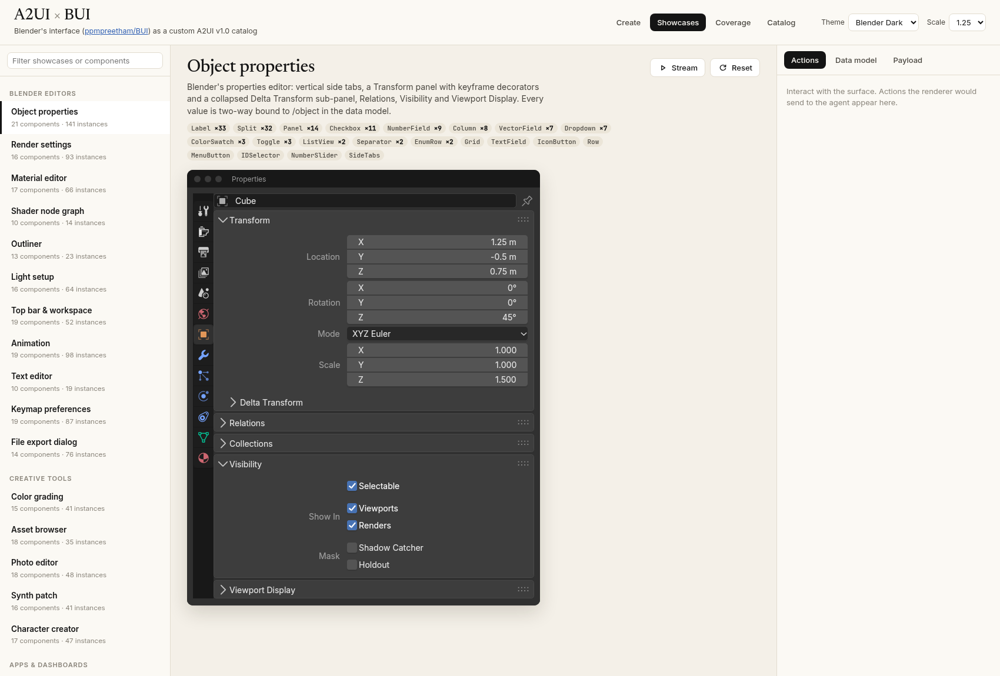
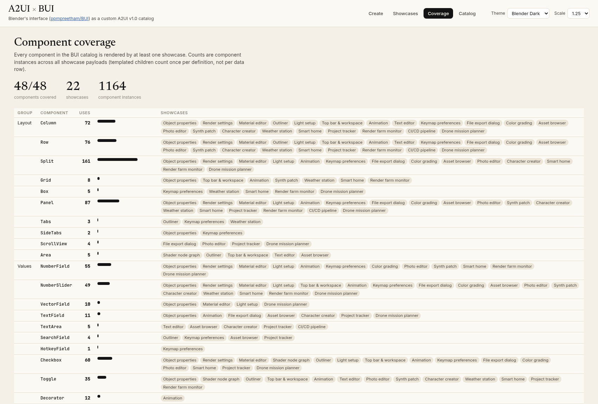
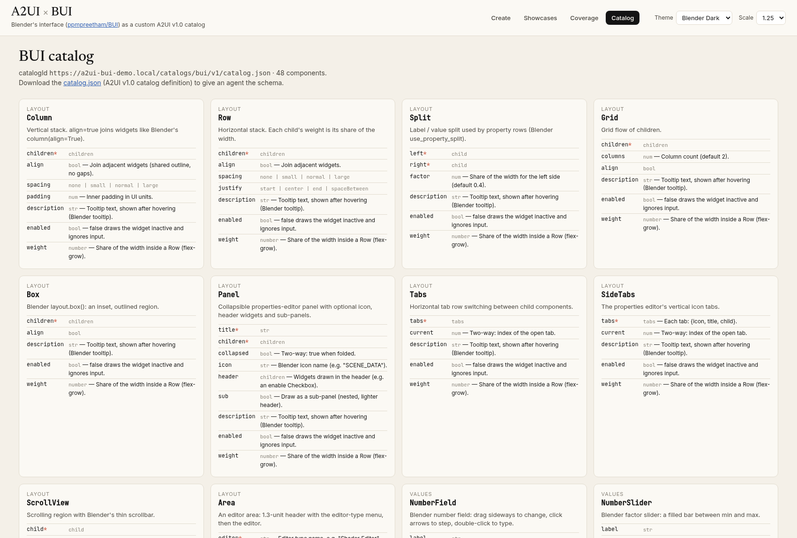

# A2UI × BUI

[BUI](https://github.com/ppmpreetham/BUI), which is Blender's user interface as a library, packaged as a custom **A2UI v1.0 catalog**,
with a web gallery of 22 showcases that between them use all 48 components.


BUI itself draws in native windows only, with no browser. This demo re-implements BUI's component library (same names,
props and Blender interaction rules as `docs/components.md`, and the Blender_Dark / Blender_Light theme colors from
`kit/intern/kit_theme_presets.c`) as Lit web components on the official, unmodified `@a2ui/web_core` + `@a2ui/lit`
0.14.0 renderer (`third_party/a2ui_bundle/a2ui.bundle.js`).

## Run

```
python3 server.py --port 8230    # static demo + realtime generation; open http://<host>:8230/
```

Gemini key: `$GEMINI_API_KEY` or `~/.config/a2ui_bui/gemini_api_key`.
Without a key the gallery and the cached starter examples still work (`python3 -m http.server` is enough for those).

### Create (realtime generation)

Describe a tool ("make me a shader editor") and Gemini writes A2UI v1.0 JSON Lines against the BUI catalog.
`server.py` streams each complete line to the browser over SSE, where it renders immediately. The system prompt
(`prompt/system_prompt.md` + generated catalog reference, icon names, asset list and 3 showcase examples; view it at
`/api/system_prompt`) asks for createSurface → data model → components top-down in chunks. After the stream, the
output is checked with `bui/validate.js` plus renderer errors, and one automatic repair round runs if needed.
*Refine current UI* sends the current messages + live data model for follow-up edits; *Agent answers actions*
sends surface actions back to Gemini, which answers with an updated UI.

12 starter examples (`starters/index.json`) open instantly from results pre-generated by the same pipeline
(`python3 tools/bake_starters.py`); *Regenerate live* reruns them.

The gallery has three tabs:
- **Showcases:** the live surface, an action log of what the renderer would send to the agent, the live data model, the payload, and a *Stream* button that replays the message stream.
- **Coverage:** use counts for each of the 48 components and the showcases that use it.
- **Catalog:** the props of every component.

## Screenshots

### The app

| Create (live generation) | Showcases |
|---|---|
|  |  |
| **Coverage** | **Catalog** |
|  |  |

### Showcases (Blender Dark)

**Shader editor:** `Area` + `NodeEditor` whose `Node` children come from a ChildList template over the data model.


**Workspace top bar:** `MenuBar` with nested menus, workspace `Tabs`, `PieMenu` on Q, and a viewport `Image`.


**Color grading:** `CurveMapping`, `ColorRamp`, RGB `Histogram`.


**Modular synth patch:** audio `NodeEditor`, `NumberSlider` knobs, spectrum bars.


**CI/CD pipeline:** a deploy DAG as nodes, `ListView` of commits, streamed `ProgressBar` updates.


| Asset browser | Render farm |
|---|---|
|  |  |
| **Smart home** | **Weather station** |
|  |  |

| Object properties | Outliner (Blender Light) |
|---|---|
|  |  |

### Blender Light theme

| Material editor | Keymap preferences |
|---|---|
|  |  |

## Layout

| Path | What |
|---|---|
| `bui/spec.js` | Single source of truth: the 48 components and their props |
| `bui/catalog.json` | A2UI v1.0 catalog definition for agents (`node tools/build_catalog.mjs`) |
| `bui/base.js` | `BuiElement` (extends `A2uiLitElement`), two-way `set()`, `fire()` actions, popups, drag |
| `bui/components/*.js`, `bui/css/*.css` | Component groups: layout, values, choice, buttons, menus, views, editors, nodes |
| `bui/host.js` | `mountSurface(container, messages, {theme, scale, onAction, onData})` + Blender tooltips |
| `showcases/*.json` | Message streams, **generated** by `python3 tools/build_showcases.py` |
| `assets/` | Procedural images/video (`python3 tools/make_assets.py`) |
| `tools/validate_showcases.mjs` | Checks payloads against spec.js (props, enums, refs, bindings, coverage of all 48) |
| `server.py`, `create.js`, `prompt/` | Realtime generation pipeline and Create tab |
| `starters/` | Starter prompts + cached generations (`tools/bake_starters.py`) |
| `tools/shot.py` | Headless-Chrome screenshots + error check for every showcase |

Catalog id: `https://a2ui-bui-demo.local/catalogs/bui/v1/catalog.json`. Icons use Blender icon names, which are drawn with
Material Symbols. BUI's own icon SVGs and code are GPL and are not copied here.

## License

Apache-2.0 (see `LICENSE`). See [CONTRIBUTING.md](CONTRIBUTING.md) to contribute.

Third-party code is kept in `third_party/`. `third_party/a2ui_bundle/a2ui.bundle.js` bundles the published `@a2ui/web_core`
and `@a2ui/lit` packages (Apache-2.0) and their dependencies, including Lit (BSD-3-Clause), Zod (MIT) and others. Every
package and its license is listed in `third_party/a2ui_bundle/README.md` and `third_party/a2ui_bundle/LICENSE`.

BUI (GPL-3.0-or-later) is referenced for component names, behavior and theme colors only; none of its code or icons are
included. Blender is a trademark of the Blender Foundation; this project is not affiliated with or endorsed by it.

## Disclaimer

This is a personal project. It is not affiliated with, sponsored by, or endorsed by any employer, the A2UI project, BUI,
or the Blender Foundation.
