# A2UI × BUI

[BUI](https://github.com/ppmpreetham/BUI) (Blender's user interface as a library) as an **A2UI v1.0 renderer**: A2UI
messages from an agent are processed by the official A2UI framework ([`a2ui-core`](https://pypi.org/project/a2ui-core/))
and drawn by BUI's real widget engine, the C port of Blender's `interface_widgets.cc`. Nothing is re-implemented in
HTML. A custom catalog (48 components) describes BUI's component library to agents, and a web gallery of 22 showcases
uses all of them.

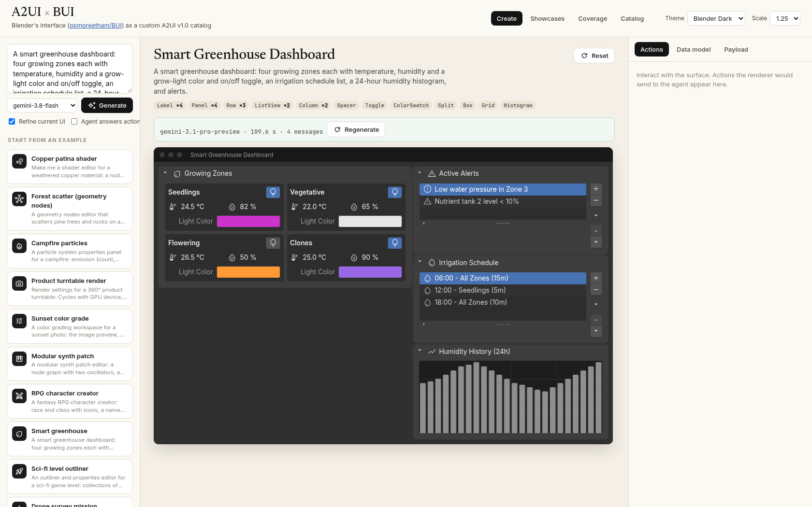

## How it works

```
 agent (Gemini via server.py, showcases, starters)
   │  A2UI v1.0 JSON Lines: createSurface · updateDataModel · updateComponents
   ▼
 a2ui-core  MessageProcessor → SurfaceModel + DataModel → NodeResolver → ComponentNode tree
   │        (validation, bindings, templates, functions, actions: the official framework)
   ▼
 a2ui_bui   one adapter per catalog component: ComponentNode ⇄ bui.components widget
   │        two-way values write the data model; widget events fire A2UI actions
   ▼
 BUI        Blender's widget drawing, input rules (drag to scrub, Ctrl snap, typed math, undo, menu search)
   ├── native window   a2ui-bui --showcase shader-nodes            (X11 / Win32 / Cocoa, CPU or GPU)
   └── headless stream server.py /ws/surface → viewport.js canvas    (damaged tiles as PNG, input back)
```

BUI draws into native windows or a headless raster; it has no browser target. The web demo therefore runs BUI on the
server and streams the pixels: `viewport.js` paints damaged regions onto a `<canvas>` and sends pointer and keyboard
input back, so every Blender interaction behaves exactly as in BUI. Actions go back to the page (and, with *Agent
answers actions*, to Gemini) as A2UI v1.0 client-to-server `action` messages.

## Run

```
python3 -m venv venv && venv/bin/pip install -e renderer/      # a2ui-core + blenderui (BUI) + a2ui_bui
venv/bin/python server.py --port 8230                           # web demo: http://<host>:8230/
venv/bin/a2ui-bui --showcase shader-nodes                       # the same surface in a native BUI window
venv/bin/a2ui-bui --showcase all --screenshot /tmp/shots/       # headless PNGs of every showcase
venv/bin/a2ui-bui --connect http://localhost:8230 --prompt "a shader editor for weathered copper"
```

Gemini key: `$GEMINI_API_KEY` or `~/.config/a2ui_bui/gemini_api_key`. Without a key the gallery and the cached starter
examples still work.

`renderer/` needs `blenderui` with `TextArea`, `FileBrowser`, child editing (`insert/remove/replace/clear`) and a node
editor `height` (proposed upstream; see [BUI changes](#bui-changes)). Until they ship on PyPI, install BUI from a checkout of
that branch (`cmake -S . -B build && cmake --build build --target buipy`, then
`BUIPY_BUILD_DIR=build/bindings/python pip install -e bindings/python`). With an older `blenderui`, `TextArea` falls back
to read-only labels and `FileBrowser` to a list.

### Create (realtime generation)

Describe a tool ("make me a shader editor") and Gemini writes A2UI v1.0 JSON Lines against the BUI catalog.
`server.py` streams each complete line to the browser over SSE; the browser forwards it to its BUI session, where it
renders immediately. The system prompt (`prompt/system_prompt.md` + generated catalog reference, Blender icon names,
asset list and 3 showcase examples; view it at `/api/system_prompt`) asks for createSurface → data model → components
top-down in chunks. The output is checked with `bui/validate.js` plus renderer errors, and one automatic repair round
runs if needed. *Refine current UI* sends the current messages + live data model for follow-up edits; *Agent answers
actions* sends surface actions back to Gemini, which answers with an updated UI.

12 starter examples (`starters/index.json`) open instantly from results pre-generated by the same pipeline
(`python3 tools/bake_starters.py`); *Regenerate live* reruns them.

The gallery has three tabs:
- **Showcases:** the live surface, an action log of what the renderer sends to the agent, the live data model, the payload, and a *Stream* button that replays the message stream.
- **Coverage:** use counts for each of the 48 components and the showcases that use it.
- **Catalog:** the props of every component.

## Screenshots

All surfaces below are drawn by BUI (`a2ui-bui --screenshot`).

### Showcases (Blender Dark)

**Shader editor:** `Area` + `NodeEditor` whose `Node` children come from a ChildList template over the data model.

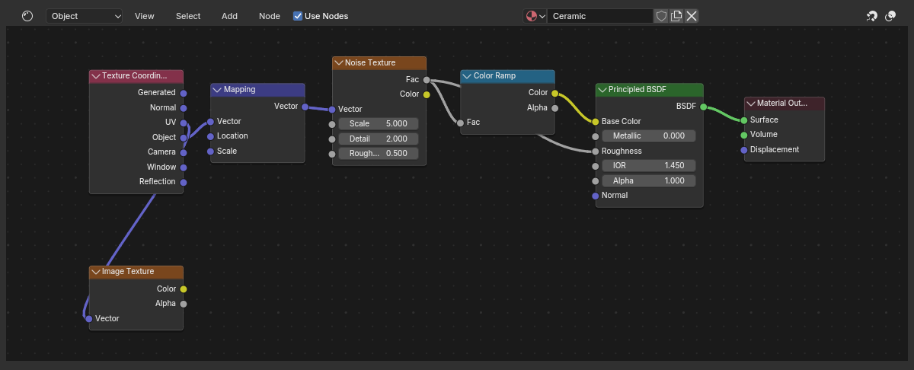

**Workspace top bar:** `MenuBar` with nested menus, workspace `Tabs`, `PieMenu` on Q, and a viewport `Image`.

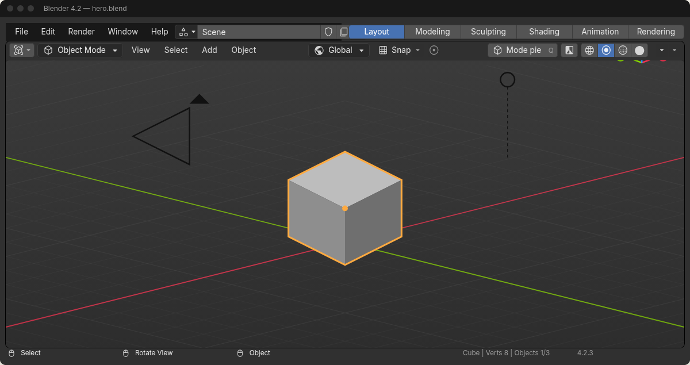

**Color grading:** `CurveMapping`, `ColorRamp`, RGB `Histogram`.

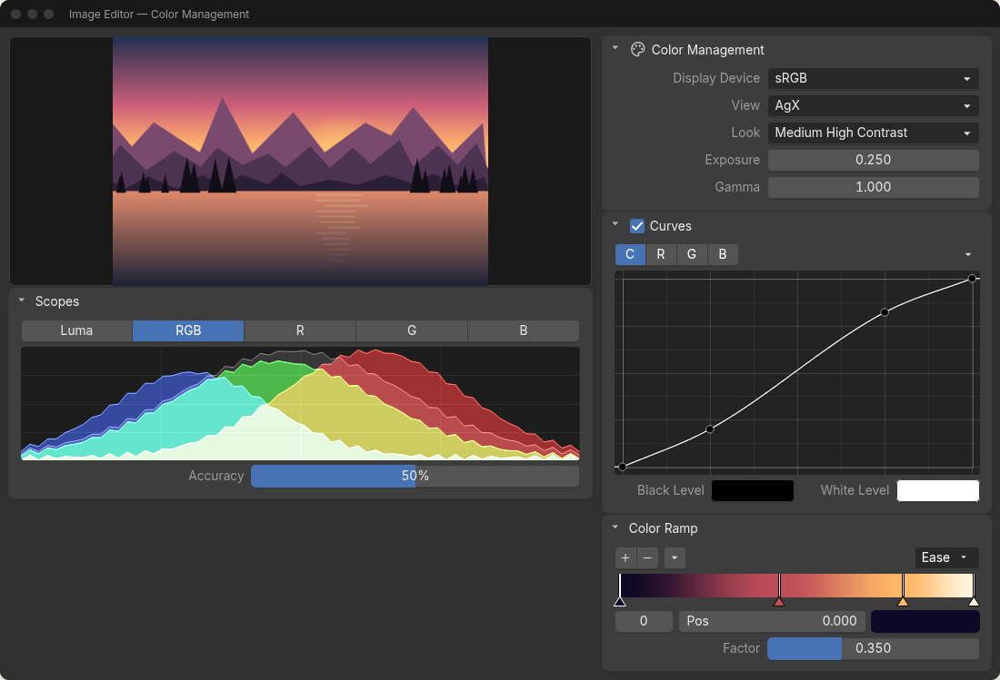

**Modular synth patch:** audio `NodeEditor`, `NumberSlider` knobs, spectrum bars.

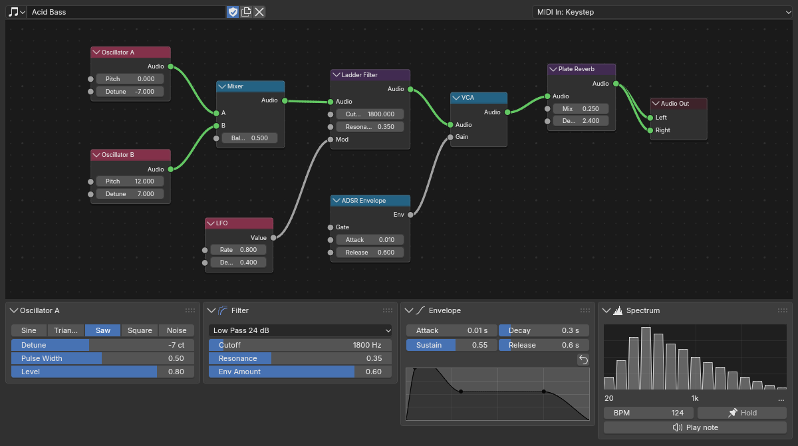

**CI/CD pipeline:** a deploy DAG as nodes, `ListView` of commits, streamed `ProgressBar` updates.

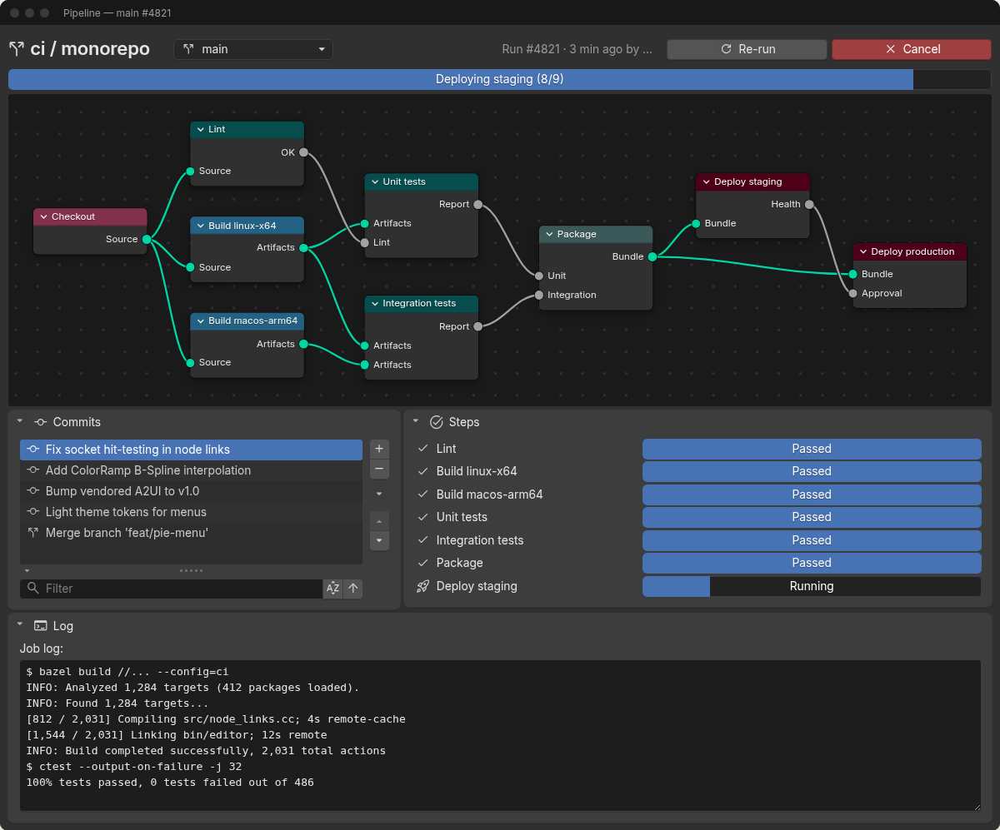

| Asset browser | Render farm |
|---|---|
| 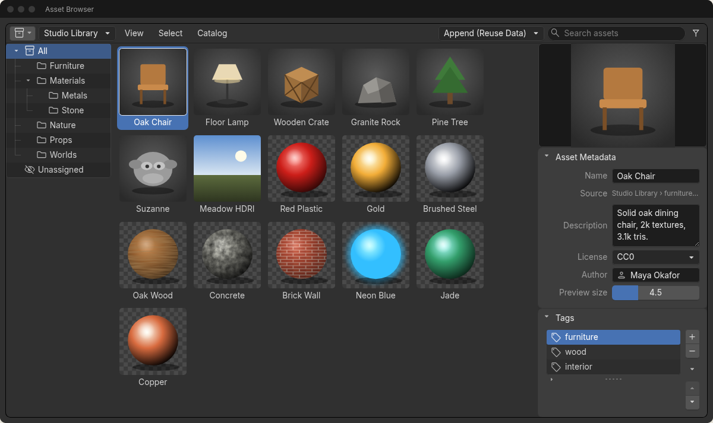 | 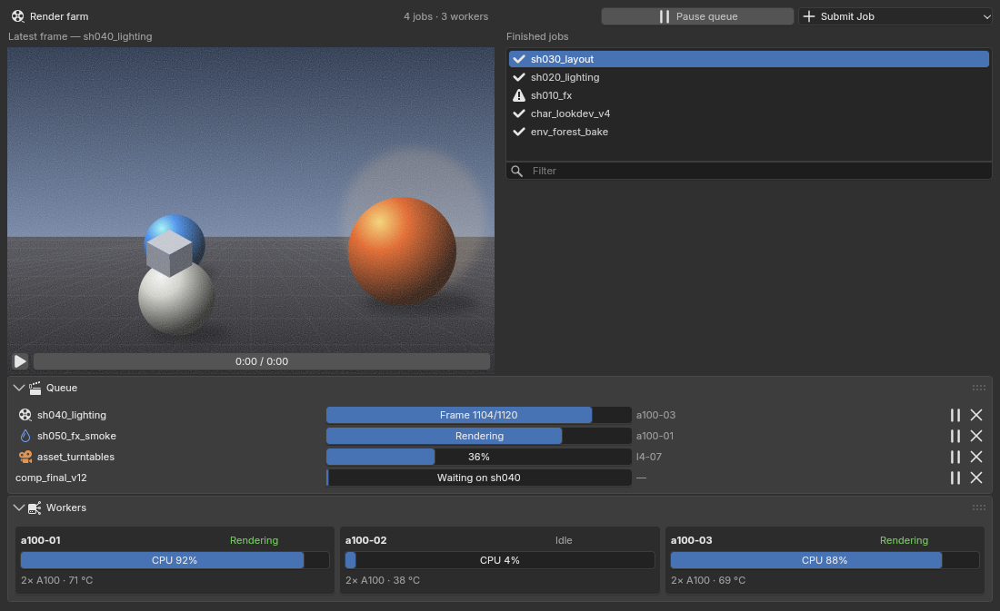 |
| **Smart home** | **Weather station** |
| 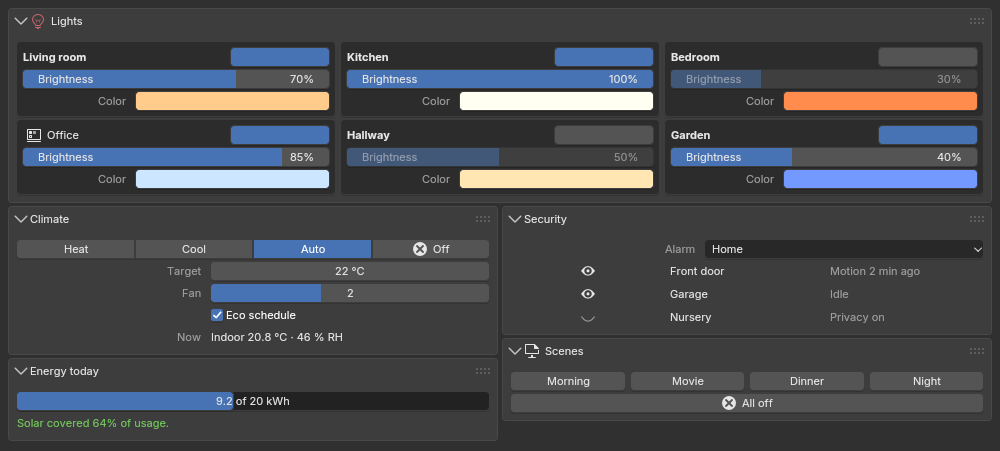 | 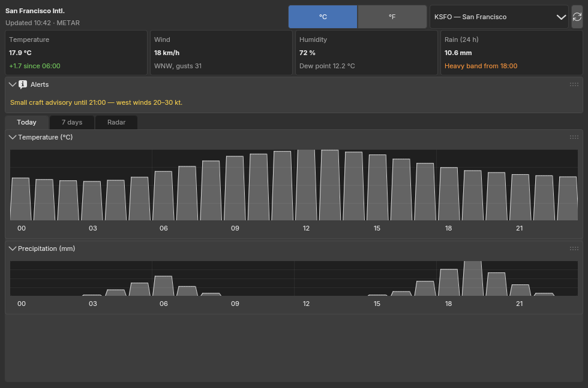 |

| Object properties | Outliner (Blender Light) |
|---|---|
| 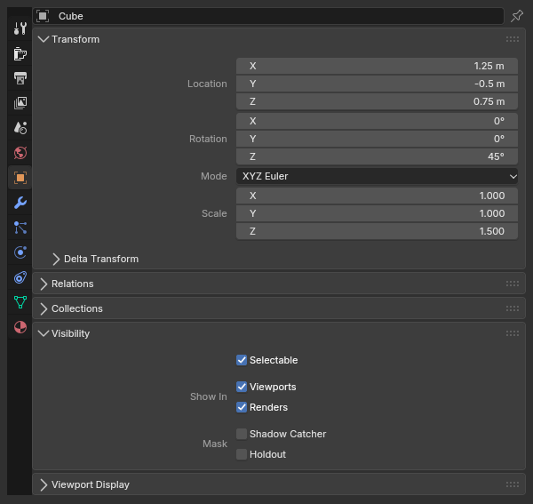 | 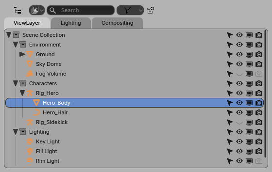 |

### Blender Light theme

| Material editor | Keymap preferences |
|---|---|
| 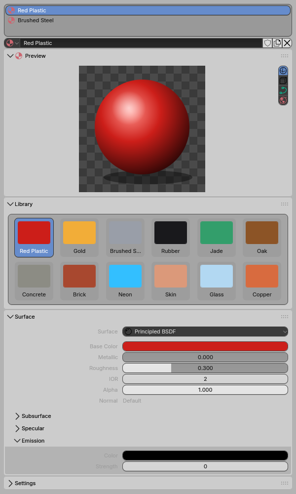 | 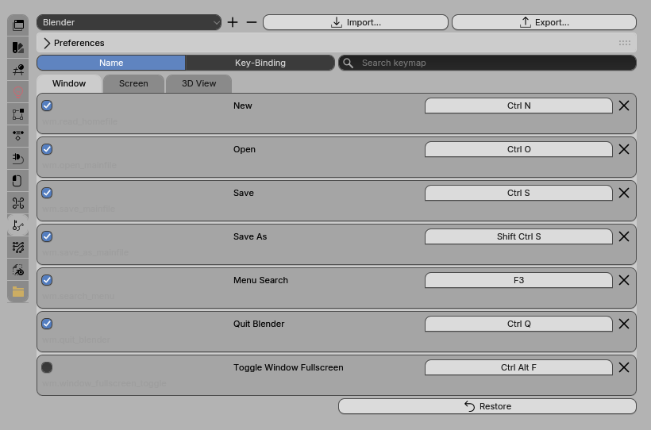 |

## Layout

| Path | What |
|---|---|
| `bui/spec.js` | Single source of truth: the 48 components and their props |
| `bui/catalog.json` | A2UI v1.0 catalog definition for agents and the renderer (`node tools/build_catalog.mjs`) |
| `renderer/a2ui_bui/renderer.py` | `BuiRenderer`: a2ui-core `MessageProcessor` → per-surface `NodeResolver` → BUI widget tree, in-place updates |
| `renderer/a2ui_bui/adapters/*.py` | One adapter per component: layout, values, choice, buttons, views, menus, editors, nodes, files |
| `renderer/a2ui_bui/hosts/` | `native.py` (BUI window), `headless.py` (raster, damage tiles, input), `stream.py` + `ws.py` (web stream) |
| `renderer/a2ui_bui/compat.py` | Workarounds where a2ui-core 0.6.0 differs from the v1.0 schema (ChildList template `path`) |
| `renderer/tests/` | End-to-end tests: every showcase renders without errors, two-way data, actions, streaming |
| `viewport.js` | Browser side of the stream: canvas, tiles, input, `mountSurface()` |
| `showcases/*.json` | Message streams, **generated** by `python3 tools/build_showcases.py` |
| `assets/` | Procedural images/video (`python3 tools/make_assets.py`) |
| `tools/validate_showcases.mjs` | Checks payloads against spec.js (props, enums, refs, bindings, coverage of all 48) |
| `server.py`, `create.js`, `prompt/` | Realtime generation pipeline, Create tab, WebSocket endpoint |
| `starters/` | Starter prompts + cached generations (`tools/bake_starters.py`) |

Catalog id: `https://a2ui-bui-demo.local/catalogs/bui/v1/catalog.json`. Icons are Blender's icon names, drawn by BUI
with Blender's own icons (`tools/icon_names.py` checks the prompt's list).

## BUI changes

The renderer needed a few additions to BUI's Python components, proposed upstream (branch `a2ui-renderer-support`):
`TextArea` and an embeddable `FileBrowser` component over existing kit nodes, child editing on containers
(`insert`, `remove`, `replace`, `clear`, so `updateComponents` can patch a live tree in place), and the node editor
honoring its `height`. Known gaps that would need more kit work: virtual (non-filesystem) file browser entries, per-row
meta text in lists and trees, image tiles in `GridView`, child widgets inside graph nodes.

## License

GPL-3.0-or-later (see `LICENSE`), the same license as BUI, which the renderer uses. `a2ui-core` is Apache-2.0.
Blender is a trademark of the Blender Foundation; this project is not affiliated with or endorsed by it.

See [CONTRIBUTING.md](CONTRIBUTING.md) to contribute.

## Disclaimer

This is a personal project. It is not affiliated with, sponsored by, or endorsed by any employer, the A2UI project, BUI,
or the Blender Foundation.
